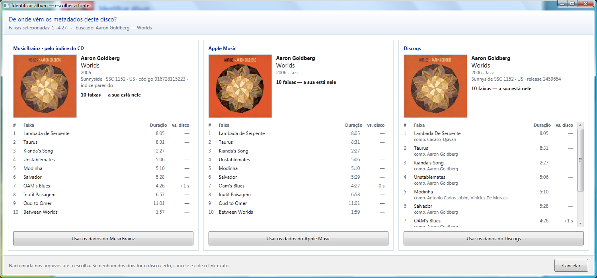
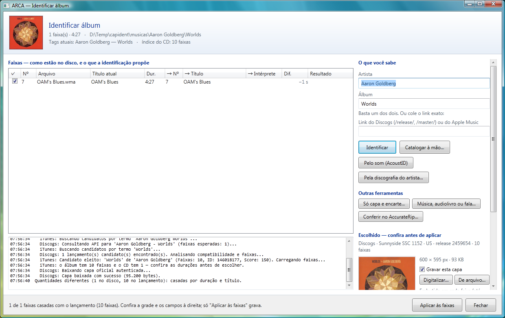
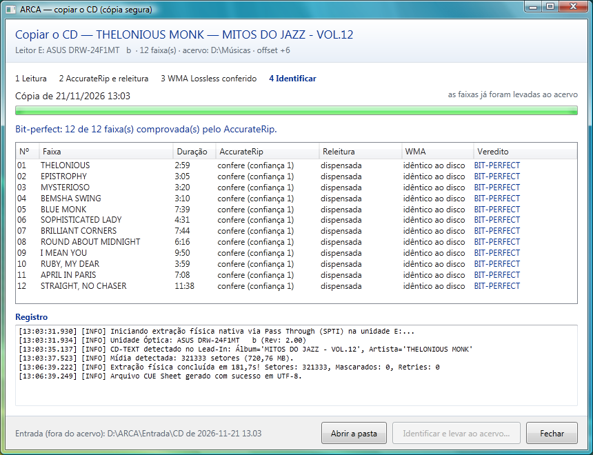
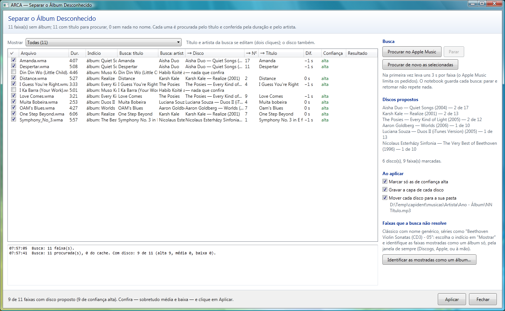
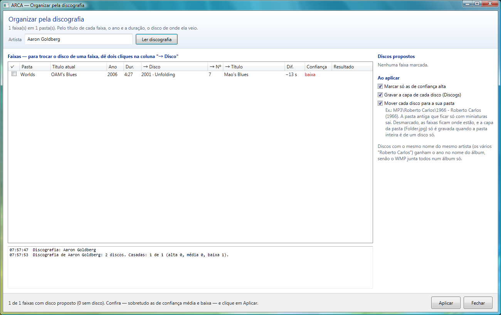
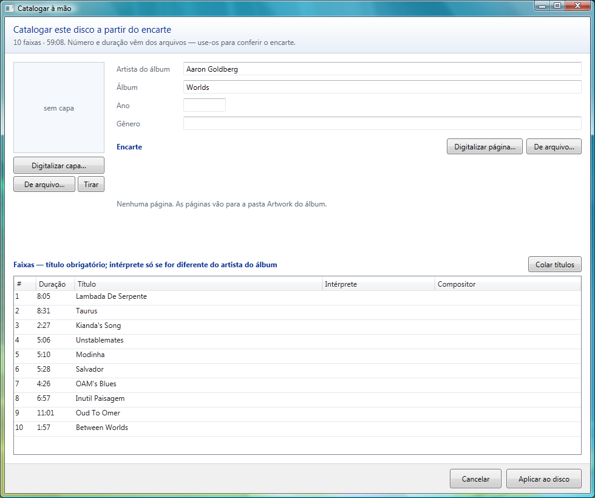
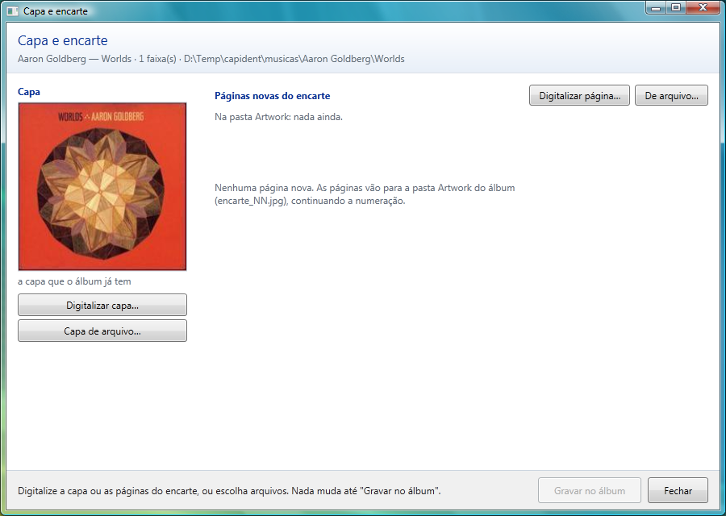
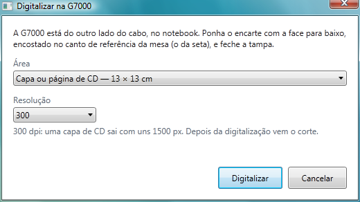
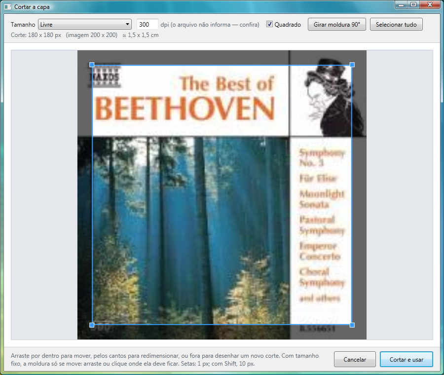
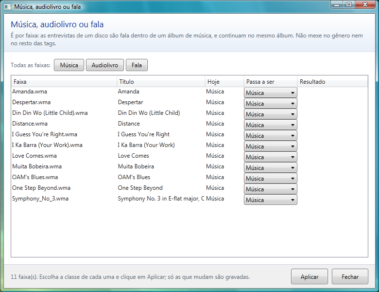

# ARCA Identificação de Álbuns

**O "Localizar Informações sobre o Álbum" do Windows Media Player 11, refeito para quem cuida de um acervo de verdade.**

Clique com o botão direito num álbum da biblioteca do WMP e escolha **Localizar Informações sobre o Álbum**. No lugar da janela antiga do player, que dependia de um serviço desligado há anos, abre o **ARCA Identificar**. Ele:

- identifica o disco pelo **índice do CD** gravado nas faixas (MusicBrainz e GnuDB), pelo **nome** (Apple Music e Discogs), pelo **link** exato ou pelo **som** (AcoustID);
- mostra as fontes **lado a lado**, com capa, faixas e durações comparadas às suas, para você escolher;
- grava título, número, artistas, compositores, ano, gênero e capa em **MP3 e WMA**, com o áudio **conferido byte a byte**: o som nunca muda;
- **copia o CD** no lugar do "Copiar do CD" do WMP: leitura direta do leitor, offset corrigido, conferência no **AccurateRip** e WMA Lossless **idêntico ao disco, amostra a amostra**, sem nada entrar no acervo antes da sua aprovação;
- confere no AccurateRip o que já foi ripado, digitaliza capa e encarte num scanner de rede, separa o "Álbum Desconhecido" em discos e organiza um artista pela discografia.

Tudo em janelas nativas do Vista, editáveis no designer do Visual Studio 2010.



---

## Como ele entra no WMP

O WMP 11 não oferece um jeito de trocar o "Localizar Informações sobre o Álbum". A ARCA faz isso com uma **ponte**, a `ARCAPonte.dll`: um plug-in de segundo plano do próprio WMP, em C++, que:

1. **acrescenta o item "ARCA: identificar álbum"** ao *Enviar para* do menu de contexto. O WMP entrega as faixas selecionadas, e a ponte grava a lista e abre o `ARCAIdentificar.exe`;
2. **desvia o comando 7312**, o "Localizar Informações sobre o Álbum" da biblioteca, para esse mesmo item. O id do item do *Enviar para* é dinâmico, e a ponte o lê no submenu quando o menu de contexto abre. Vale só o item do mesmo menu: na vista de cópia do CD, que não tem *Enviar para*, o comando fica com o WMP;
3. **põe "ARCA: copiar este CD (cópia segura)"** no menu do botão **Copiar do CD**, logo abaixo do item do WMP, e abre a cópia segura para o leitor daquele item.

A ponte não toca na rede nem nos arquivos de música. Quem grava é o Identificar, e o WMP vê as mudanças sozinho, porque elas estão no próprio arquivo.

## A janela de identificação



**Faixas.** A grade mostra as faixas como estão no disco e o que a identificação propõe: número, título, intérprete e a **diferença de duração** de cada uma, em verde, âmbar ou vermelho. Faixas avulsas, de um álbum que você não tem inteiro, são pareadas pelo título e pela duração, e não pela posição.

**Fontes**, consultadas em paralelo:

| Fonte | Por quê |
|---|---|
| **MusicBrainz** | pelo *Disc ID* do índice do CD que o WMP grava em cada faixa ripada (`WM/MCDI` no WMA, quadro `MCDI` no MP3): o disco **exato**, com a capa do Cover Art Archive |
| **GnuDB** | o mesmo índice, no antigo freedb |
| **Apple Music** | pelo artista e pelo álbum: capa em alta resolução, gênero |
| **Discogs** | pelo artista e pelo álbum: gravadora, catálogo, país, **compositores** de cada faixa |
| **AcoustID** | pela **impressão digital do som**, para faixa sem nome nenhum ("Faixa 1, Faixa 2…"). Só a impressão sai da máquina, nunca o áudio |
| **Link** | cole o endereço exato de um lançamento do Discogs ou do Apple Music |

**Proposta.** Os dados escolhidos aparecem à direita para conferir e editar: artista, álbum, ano, gênero e capa. A capa pode ser a da fonte, uma digitalizada na hora ou uma de arquivo. Nada é gravado antes de **Aplicar às faixas**.

## Gravação segura

Um acervo não aceita um "quase". Toda gravação, de qualquer janela, passa pelo mesmo caminho:

1. **Cópia.** Uma cópia da faixa (`.arca-partial`) recebe as tags e a capa: MP3 pelo taglib-sharp (ID3v2.3), WMA pelo *Windows Media Format SDK*, o mesmo motor do WMP.
2. **Conferência do áudio.** O **SHA-256 do áudio** da cópia é comparado com o do original:
   - no MP3, os quadros sem as tags do começo e do fim (ID3v2, ID3v1 em qualquer quantidade, APEv2, Lyrics3);
   - no WMA, o *Data Object* do ASF.
3. **Troca.** Só com o áudio idêntico a cópia substitui o original (`File.Replace`), e a conferência é refeita no arquivo final.
4. **Registro.** Cada gravação vira uma linha num **ledger** (JSONL) com o antes, o depois e a fonte.

**A capa:**
- embutida em cada faixa, até 1000 px;
- em `Folder.jpg` e `AlbumArtSmall.jpg`, ocultos, como o WMP faz;
- a versão plena em `Artwork\capa.jpg`, junto das páginas do encarte.

## Cópia segura do CD



**No WMP: guia Copiar do CD › setinha do botão Copiar do CD › ARCA: copiar este CD (cópia segura).** O rip do WMP lê o disco uma vez, não corrige o deslocamento do leitor e não diz se a leitura foi exata. A cópia da ARCA:

1. **lê o disco direto do leitor** (SCSI pass-through, sem administrador), setor a setor, tentando de novo os setores difíceis. O que não se lê vira silêncio **e fica registrado**, nunca escondido;
2. **confere no AccurateRip** cada faixa contra as assinaturas de quem ripou o mesmo CD. O que a base não confirmar é **lido de novo** e comparado setor a setor;
3. **corrige o offset do leitor** (pela tabela do AccurateRip, confirmada pelo próprio disco) e corta as faixas;
4. **codifica em WMA Lossless** pelo mesmo motor do WMP e **decodifica de volta**: o SHA-256 do áudio tem de ser o do trecho do disco;
5. grava em cada faixa o índice do CD (`WM/MCDI`), o leitor e o veredito (`ARCA/Verification`).

**Prudência.** As faixas vão para uma **pasta de entrada, fora do acervo** e das pastas que o WMP vigia. No fim, o Identificar abre sozinho e já procura o disco pelo índice do CD. O disco só entra no acervo (`Artista\Álbum\NN Título.wma`) quando você clica em **Aplicar às faixas**. Se alguma faixa não sair comprovada, a janela para e mostra qual, e a decisão é sua.

**Exemplo real:** *Mitos do Jazz, vol. 12 — Thelonious Monk* (Abril Coleções).
- Leitura de 720,8 MB em 3 minutos, nenhum setor perdido, offset +6.
- **12 de 12 faixas conferem no AccurateRip**; 12 de 12 WMA idênticos ao disco.
- Uma **segunda cópia independente** saiu idêntica à primeira, amostra a amostra, nas 12 faixas.

## As outras ferramentas

### Separar o Álbum Desconhecido



**Para o "Unknown Album" do WMP,** onde caem centenas de faixas soltas. Cada faixa é procurada pelo título no Apple Music e conferida pela duração e pelo artista; a janela propõe o disco de cada uma, com uma nota de confiança.
- **O título vem da tag ou do nome do arquivo,** inclusive de tags antigas quebradas, que nem o WMP lê.
- **Ao aplicar,** cada disco ganha tags, capa e pasta própria (`Artista\Ano - Álbum\NN Título`).
- **Faixa sem resolução pelo título** (clássico com nome genérico, por exemplo): o botão abaixo abre as faixas na janela de identificação, como um álbum só.

### Organizar pela discografia



**Para o artista cujo "álbum" é só o ano,** ou para faixas de vários discos misturadas. A janela lê a discografia do artista no Discogs e descobre o disco de cada faixa:
- pelo título, sem acento, por letras e por palavras;
- pelo ano e pela duração;
- pela pasta de origem.

**Testada com 369 faixas de um artista com mais de 300 discos:** 362 casadas com confiança alta. Só a confiança alta vem marcada. Na imagem acima, o palpite errado para uma faixa que não está na discografia ficou com confiança **baixa** e não seria gravado.

### Catalogar à mão



**Para o disco que nenhum catálogo conhece: o encarte é a fonte.**
- Número e duração vêm dos arquivos, para conferir com o encarte.
- Títulos, intérpretes e compositores são digitados, ou colados de uma vez.
- A capa e as páginas do encarte vêm do scanner.

### Capa e encarte, sem mexer nas tags



### Scanner pela rede e corte





**A digitalização usa uma multifuncional de rede** (eSCL/WIA), pelo ARCA Central, sem diálogo de driver. Três áreas pré-definidas: capa de CD, encarte aberto e mesa inteira. A imagem chega em PNG, sem perda, e vai para o corte (quadrado para a capa) e para a divisão de páginas duplas.

### Música, audiolivro ou fala



**Marca cada faixa como música, audiolivro ou fala** (entrevista, humor, aula), para o WMP separar os audiolivros da música. Funciona com os atributos `WM/MediaClass*` no WMA e com quadros PRIV no MP3.

### Conferir no AccurateRip

**Para WMA ripado pelo WMP (com o índice do CD):** confere se cada faixa é **bit-perfect**, comparando as assinaturas dela com as de quem ripou o mesmo CD.
- A base vem pelo ARCA Central; a conta é feita localmente, sobre o áudio decodificado.
- O deslocamento do leitor é procurado automaticamente.
- Exemplo real: *Buenos Hermanos* (Ibrahim Ferrer), **13 de 13 faixas conferem**, deslocamento +6.

---

## Arquitetura: a máquina do WMP não precisa de internet

O Identificar foi feito para um PC de 2009 com **Windows Vista**, que **não sai para a internet** por decisão de segurança: sem atualizações há anos e sem TLS 1.2. Quem conversa com o mundo é o **ARCA Central**, um serviço pequeno noutra máquina da rede local, com Windows moderno.

```
 Windows Vista (WMP 11)                              Windows 10/11 (com internet)
 ┌──────────────────────────────┐   rede local   ┌──────────────────────────────────┐
 │ WMP ─► ARCAPonte.dll          │   HTTP/JSON    │ ARCA Central                      │
 │         └► ARCAIdentificar.exe ├───────────────►│  /buscar /link /toc /som /faixa   │──► Apple Music, Discogs,
 │            (janelas, gravação,│                │  /discografia /accuraterip        │    MusicBrainz, GnuDB,
 │             conferência)      │◄───────────────┤  /digitalizar ─► scanner de rede │    AcoustID, AccurateRip
 └──────────────────────────────┘                └──────────────────────────────────┘
```

**O Central não é um proxy:**
- **Rotas fixas:** atende só as rotas acima, não há como pedir outro site.
- **Um cliente:** escuta num endereço e só aceita a máquina do WMP, os dois em `central.ini`.
- **Respeito aos limites:** guarda cache das consultas (cada lançamento do Discogs para sempre, a discografia por 30 dias) e espaça os pedidos conforme cada serviço.

**Código dividido.** O Identificar (.NET 4.0, no Vista) e o Central (.NET 4.8) compilam os **mesmos** clientes de busca e o mesmo modelo, em `Comum\`. O protocolo entre os dois, em `Central\Protocolo.cs`, também é um arquivo só.

## Estrutura

| Pasta | O que é |
|---|---|
| `Identificar\` | o programa (WPF, .NET 4.0, x86): 13 janelas em XAML, o tema, o gravador, os casadores, a cópia do CD |
| `Ponte\` | a `ARCAPonte.dll` (C++, VC10), o plug-in que mora dentro do WMP |
| `Central\` | o ARCA Central (.NET 4.8): servidor HTTP mínimo, MusicBrainz, GnuDB, AcoustID, discografia, scanner |
| `Comum\` | os clientes de busca (Apple, Discogs, GnuDB), o AccurateRip, o editor de tags ASF, o modelo e o motor da cópia do CD (leitura SCSI, conferência, WMA Lossless) |
| `Testes\` | 64 testes MSTest (35 de unidade, 29 de integração) |
| `Bibliotecas\` | taglib-sharp 2.1 (LGPL), para as tags de MP3 |

## Requisitos e instalação

**Na máquina do WMP:**
- Windows Vista ou 7, Windows Media Player 11 (32 bits) e .NET Framework 4.0.

**Para compilar:**
- Visual Studio 2010 (C# e C++).
- O Central compila só com o .NET Framework 4.8 (`csc`), sem Visual Studio.

**Passos:**
1. **Compilar.** Na máquina do WMP, `compilar.cmd ponte` gera `bin\ARCAPonte.dll` e `bin\ARCAIdentificar.exe`. Feche o WMP antes, porque a ponte fica presa enquanto ele está aberto.
2. **Registrar.** `instalar.cmd`, como administrador, registra a ponte no WMP. Para tirar: `desinstalar.cmd`.
3. **Subir o Central** na máquina com internet:
   - `Central\compilar.ps1` gera `%LOCALAPPDATA%\ARCA-Central\ARCACentral.exe`;
   - ao lado dele vão as chaves: `discogs.chave`, com o seu [token pessoal do Discogs](https://www.discogs.com/settings/developers), e `acoustid.chave`, com uma [chave de aplicação do AcoustID](https://acoustid.org/new-application);
   - também ao lado: o `fpcalc.exe` do [Chromaprint](https://acoustid.org/chromaprint), para a busca pelo som;
   - se os endereços forem outros que os padrão, um `central.ini` (veja `Central\central.ini.exemplo`).
4. **Apontar o Identificar para o Central.** O endereço vai em `ArcaCentral`, no `ARCAIdentificar.exe.config`. No mesmo arquivo ficam `PastaDeEntrada`, onde a cópia do CD espera a aprovação, e `Acervo`, para onde o Aplicar a leva.

**Para copiar um CD:** no WMP, guia **Copiar do CD**, setinha do botão **Copiar do CD** › **ARCA: copiar este CD (cópia segura)**.

**Para identificar:** na biblioteca do WMP, clique com o botão direito num álbum e escolha **Localizar Informações sobre o Álbum**, ou use **Enviar para › ARCA: identificar álbum**. Ao escolher várias pastas de uma vez, o Identificar abre direto na organização pela discografia.

## Testes

`Testes\rodar-testes.cmd [Unidade|Integracao]`, ou no Visual Studio 2010, em Teste › Executar.

| Categoria | O que confere |
|---|---|
| **Unidade** (35) | o corte de um disco sintético em WMA Lossless com offset 0, +6 e −30, conferido contra um SHA-256 que o próprio teste calcula; o CD-TEXT, inclusive com pacote corrompido; o hash do áudio (tags diferentes, ID3v1 empilhadas, um byte de áudio mudado); tags quebradas; o índice do CD (o Disc ID confere com o MusicBrainz, MCDI em texto e binário); o arquivo do AccurateRip; o casamento de faixas soltas e avulsas; a confiança; os nomes de faixa, pasta e álbum |
| **Integração** (29) | o leitor de CD real (modelo, offset, índice, CD-TEXT, leitura repetida idêntica); uma segunda cópia do CD comparada com a do acervo (com `ARCA_TESTE_COPIA_ALBUM`); gravação de MP3 e WMA numa cópia nova (move, renomeia, capa, ledger de teste, áudio intacto); a classe de mídia; o Central em todas as rotas; o AccurateRip de um disco real; as 13 janelas abrindo com faixas reais |

**Regras:**
- nenhum teste escreve no acervo nem no ledger real;
- o que é gravado é uma cópia nova, apagada no fim;
- o acervo de leitura vem da variável `ARCA_TESTE_ACERVO`.

## Licença

[MIT](LICENSE). A `Bibliotecas\taglib-sharp.dll` é do projeto [TagLib#](https://github.com/mono/taglib-sharp), sob a LGPL 2.1.
